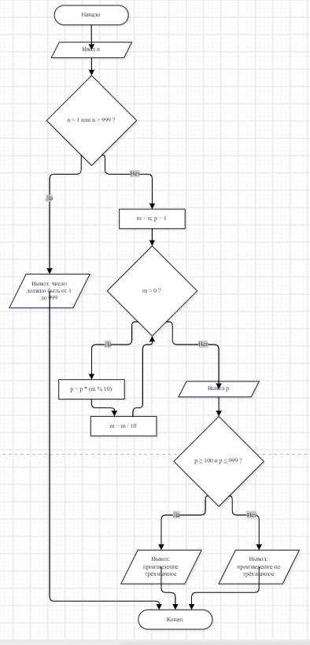

## Домашнее задание к лабораторной 6

### Вариант 11

#### Дано число N (N<1000). Написать программу, которая проверяет является ли произведение его цифр трехзначным числом.

#define _CRT_SECURE_NO_WARNINGS

#include <stdio.h>

#include <locale.h>

int main()

{

    setlocale(LC_ALL, "Russian");

    int n, m;
    int p = 1;   // произведение цифр

    printf("Введите число N (от 1 до 999): ");
    scanf("%d", &n);

    if (n < 1 || n > 999)
    {
        printf("Число должно быть от 1 до 999\n");
        return 0;
    }

    m = n;
    while (m > 0)
    {
        p = p * (m % 10);   // берём последнюю цифру
        m = m / 10;         // отбрасываем её
    }

    printf("Произведение цифр: %d\n", p);

    if (p >= 100 && p <= 999)
        printf("Произведение трёхзначное\n");
    else
        printf("Произведение не трёхзначное\n");

    return 0;
}

### Вывод
#### В работе я научилась использовать условный оператор if-else и сложные условия с && и ||. Я написала программу проверки високосного года и программу вычисления функции F(x) с разными формулами для разных x. Ещё я попробовала тернарную операцию ?: прямо внутри printf. Проверка на контрольных примерах показала, что программы работают правильно. 